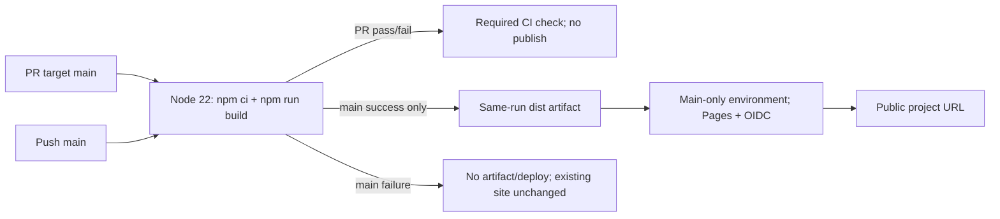

# GitHub Pages CI/CD cho TiHoMo landingpage

## Overview

Triển khai đầy đủ [brief được duyệt](../reports/brainstorm-261012-1722-github-pages-cicd.md): PR vào main chạy build gate hiện có; merge tạo main-push run build một lần và deploy same-run dist artifact tới `https://vinhltt.github.io/3_tihomo_landingpage/`. Plan này **chưa thay settings, commit/push/merge hoặc publish**.

## Contract / Scope

- HOLD SCOPE, option A explicit official Actions. Giữ Astro5/npm/static, develop, EN mặc định/VI, mười routes, shared English slugs và theme/animation/product/no-data claims hiện có.
- Chuyển repo public chỉ sau source/history disclosure preflight; main production/default, PR+CI protection cả admin, environment main-only. Không PAT, SSR/Docker, PR preview/staging, custom domain, analytics/form, redesign/SEO campaign, repo publish thứ hai hoặc phục hồi plan cũ.
- [Trade-offs và Better approaches](../reports/brainstorm-261012-1722-github-pages-cicd.md#4-trade-offs) giữ nguyên; không thêm một build convention/test framework. [Evidence](./reports/codebase-evidence.md) ghi build hiện tại pass nhưng root-only, repo private/develop/no workflows và working tree đang có thay đổi người dùng.

## Phases

| # | Phase | Dependency | Status |
|---|---|---|---|
| 1 | [Public-safety và baseline](./phase-01-start.md) | None | Pending |
| 2 | [Site publish-ready dưới base path](./phase-02-publish-ready-site.md) | 1 | Pending |
| 3 | [CI/CD GitHub Pages](./phase-03-pages-workflow.md) | 2 | Pending |
| 4 | [Bootstrap production và nghiệm thu public](./phase-04-production-bootstrap-acceptance.md) | 1, 2, 3 | Pending |

Bốn gate có thứ tự bắt buộc: irreversible exposure, local URL contract, workflow, remote launch. Không parallel implementation; ownership/docs chuyển tuần tự.

## Runtime Architecture

## Acceptance Traceability

| Brief criterion | Owning gate / evidence |
|---|---|
| 1. PR build/link/asset failures block | Phase 2 checker; phase 3 matrix; phase 4 actual PR CI |
| 2. Merge builds/deploys same-run artifact | Phase 3 needs/permissions; phase 4 SHA/artifact/deployment URLs |
| 3. Main build failure skips deploy | needs:build + guard proof; report observed vs static negative evidence explicitly |
| 4–6. Ten routes/assets/locale/theme/header | Phase 2 local and phase 4 public desktop/mobile browser |
| 7. Production metadata/sitemap/robots | Phase 2 publish-aware checker; phase 4 public + origin robots checks |
| 8. Actions source/protection/main-only | Phase 1 exposure; phase 4 settings read-back + observed required check |
| 9. Real public evidence | Phase 4 PR/run/deployment URLs, screenshots/console/network; never local = deployed |
| 10. PR-revert rollback | Phase 4 content-revert PR giữ workflow; first launch chưa có prior public revision thì corrective PR |

## Dependencies / Decisions

- [Astro research](./research/astro-publish-contract.md), [GitHub research](./research/github-pages-contract.md): no new npm dependency; static metadata endpoints; configure-pages in deploy, leaving build contents:read.
- Bootstrap A = approved site without workflow; PR B introduces workflow/runbook. No publication before protection; maintainer merges, agent never auto-merges.
- Project robots is syntax-valid, not REP-authoritative. Origin `/robots.txt` currently 404; recheck public. Root policy scope is not silently expanded to another repo.
- Native concurrency serializes active main runs but is not newest-SHA/FIFO guarantee. Content rollback preserves the workflow; never revert bootstrap B wholesale or rerun old artifacts.

## Red Team Review

[Hai Medium findings đã sửa](./reports/red-team-review.md): CSS resolution context và rollback giữ pipeline. Không Critical/High hoặc scope change.

## Validation Log

[Automatic revalidation — Session 2](./reports/plan-validation.md#session-2): PASS, 24 links/anchors, dependencies/callers/current GitHub state đều phù hợp; không lỗi mới. Bốn phase/mười hai task vẫn pending; không coi plan review là deploy evidence.

## Handoff

Phases 1–3 và P4.1 có execution evidence; source public/main bootstrap đã thực hiện theo maintainer approval, user staging/develop được giữ nguyên. [Baseline A/B](./reports/production-baseline.md), [local acceptance](./reports/base-path-local-acceptance.md), [workflow review](./reports/workflow-contract-review.md) và [remote receipts/provider blocker](./reports/github-pages-public-acceptance.md) sở hữu bằng chứng. P4.2 còn chờ actual current-head CI; P4.3–4 còn maintainer normal merge, same-run main artifact/deployment và public browser acceptance. Agent không merge/bypass hoặc dùng old-SHA green; rehydrate Todo checkboxes khi tiếp tục, không đánh dấu plan complete trước các gate còn thiếu.

<!-- slug: github-pages-cicd -->